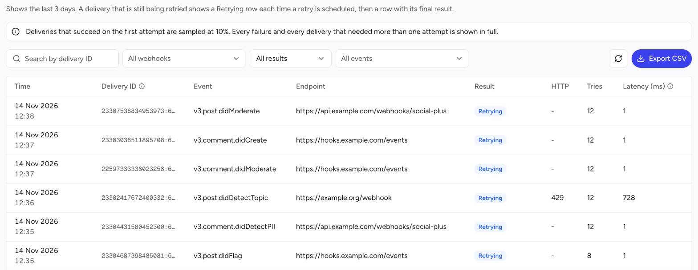
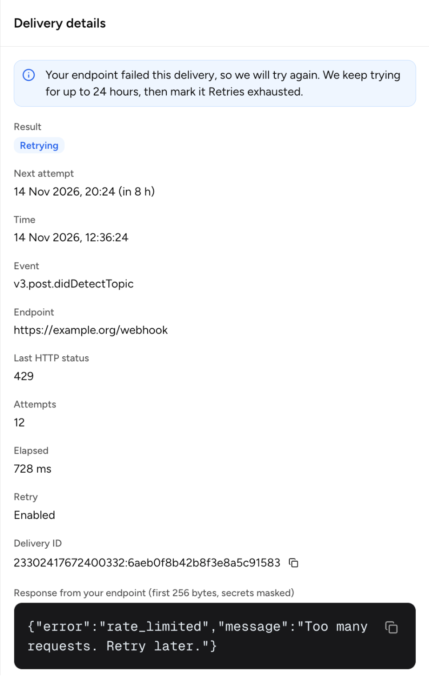
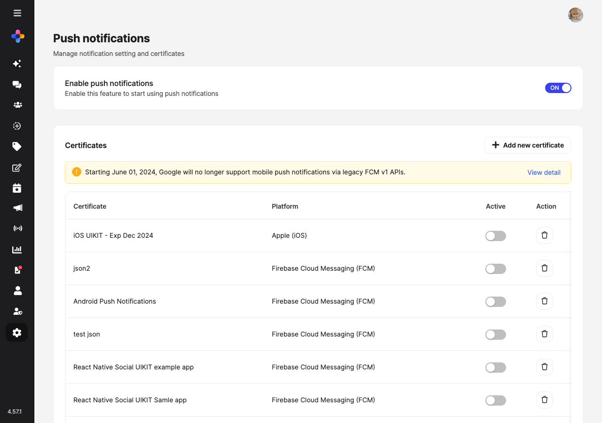
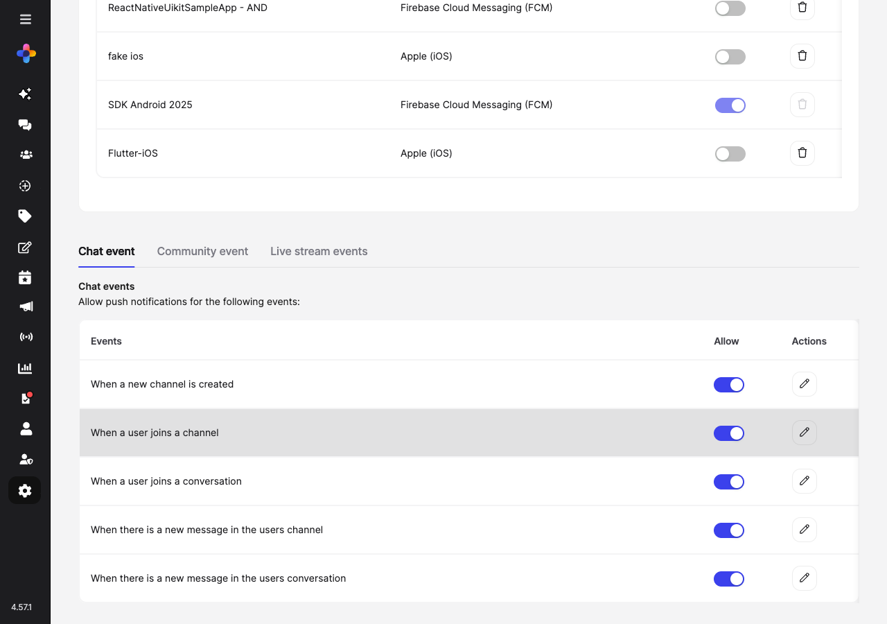

<Info>
Configure webhooks and push notification infrastructure to stream real-time events and engage users reliably.
</Info>

<CardGroup cols={3}>
  <Card title="Webhooks" icon="plug">Deliver real-time events to your backend</Card>
  <Card title="Certificates" icon="file-certificate">Upload APNs / FCM / Baidu credentials</Card>
  <Card title="Chat Events" icon="comments">Channel & conversation notifications</Card>
  <Card title="Community Events" icon="users">Post, comment, story & event notifications</Card>
  <Card title="Live Stream Events" icon="video">Standalone live stream notifications</Card>
  <Card title="Custom Payloads" icon="code">Tailor notification content per event</Card>
</CardGroup>

## Webhooks

<Info>Need full event catalog, payload schema, retry logic, and signature details? See the complete reference: <a href="/analytics-and-moderation/social+-apis-and-services/webhook-event">Webhook Events Reference</a>.</Info>

<Steps>
  <Step title="Add Endpoint">Enter HTTPS URL in **Settings → Webhook** section.</Step>
  <Step title="Choose Retry">Leave **Retry** on to retry failed deliveries for up to 24 hours. Turn it off to send each delivery once. To change it later, edit the webhook.</Step>
  <Step title="Secret Issued">Console generates secret key tied to that URL.</Step>
  <Step title="Validate Signature">Configure backend to verify HMAC (secret) per event.</Step>
  <Step title="Rotate Secret">Delete & re-add endpoint if compromise suspected.</Step>
</Steps>

<Warning>Use publicly reachable HTTPS endpoints; avoid including query secrets in the URL.</Warning>

<AccordionGroup>
  <Accordion title="Best Practices">Respond with a 2xx status within 1 second, then process the event. Skip a delivery whose `x-socialplus-delivery-id` you already handled, because retries can send it again. See [Delivery and retries](/analytics-and-moderation/social+-apis-and-services/webhook-event#delivery-and-retries).</Accordion>
  <Accordion title="Security">Restrict IPs if possible; verify signature before queuing work.</Accordion>
  <Accordion title="Versioning">Include event schema version in payload to future‑proof consumers.</Accordion>
</AccordionGroup>

### Webhook deliveries

The **Deliveries** tab in **Settings → Webhook** shows the deliveries of the last 3 days. A delivery is one event sent to one webhook. Use the tab to check that your endpoint receives events, and to find out why a delivery failed.

<Note>
Deliveries that succeed on the first try are sampled at 10%. Every failure, and every delivery that needed more than one try, is shown in full.
</Note>

Each row has one of these results:

| Result | Meaning |
|--------|---------|
| **Delivered** | Your endpoint returned a 2xx status. |
| **Failed** | The delivery failed and was not retried. For example, your endpoint returned `400`, **Retry** is off, or the webhook was deleted while a retry was waiting. |
| **Retries exhausted** | Every try failed with an error that we retry, and no tries are left. |
| **Retrying** | A try failed, and the next try is scheduled. The row shows when the next try is due. |

A retried delivery shows one **Retrying** row for each scheduled retry. The delivery then ends with one final row: **Delivered**, **Failed**, or **Retries exhausted**. For the retry schedule, see [Delivery and retries](/analytics-and-moderation/social+-apis-and-services/webhook-event#delivery-and-retries).

#### Find a delivery

- Filter the list by **Webhook**, **Result**, and **Event**.
- To find one delivery, search by its delivery ID: the value of the `x-socialplus-delivery-id` header that your endpoint received. Enter the full ID to find the delivery to one webhook. Enter only the part before the colon to find the deliveries of that event to all of your webhooks.
- To download the list, click **Export CSV**. The file has up to the newest 10,000 deliveries that match your filters.

#### Delivery details

Click a row to open **Delivery details**.

| Field | Description |
|-------|-------------|
| **Result** | Delivered, Failed, Retries exhausted, or Retrying. |
| **Next attempt** | On a **Retrying** row, when the next try is due. |
| **Time** | When the row was recorded. |
| **Event** | The event name, such as `message.didCreate`. |
| **Endpoint** | The webhook URL, without its query string. |
| **Last HTTP status** | The status code of the last try, if your endpoint responded. |
| **Attempts** | The number of tries so far, including the quick tries. |
| **Elapsed** | The latency, in milliseconds. On the first send, it includes every quick try and the pauses between them. On a scheduled retry, it covers only that one try, not the wait before it. |
| **Retry** | Whether **Retry** is on for the webhook now. |
| **Error** | The type of error when your endpoint did not respond: a timeout, a DNS, connection, or TLS error, another network error, or an invalid callback URL. |
| **Reason** | Why the delivery ended without a 2xx status, when the result alone does not say. For example, "Retry was not on for this delivery, so it was tried once". |
| **Delivery ID** | The `x-socialplus-delivery-id` value, in the format `<event ID>:<webhook ID>`. The same on every try. |
| **Response from your endpoint** | The first 256 bytes of your endpoint's response to a failed try, with secrets masked. |

## Push Notifications

Navigate to **Settings → Push notifications** in the console to manage notification settings and certificates.

### Enable Push Notifications

Use the master toggle at the top of the page to enable or disable push notifications for the entire network.

<Warning>Turning the master toggle OFF immediately disables **all** push events (Chat, Community, Live Stream). Certificates must be uploaded and active before toggling events, or notifications will silently fail.</Warning>

### Certificates

Multiple certificates can be stored per platform (e.g., staging + production), but only **one can be active at a time** per platform/provider.

<Warning>Starting June 01, 2024, Google will no longer support mobile push notifications via legacy FCM v1 APIs. Migrate to FCM v1 before this date.</Warning>

| Field | Platform Scope | Purpose |
|-------|----------------|---------|
| Certificate Name | All | Internal tracking label |
| Platform | iOS / Android | Target OS |
| Provider (Android) | Android | Firebase Cloud Messaging (FCM) / Baidu Cloud Push |
| Service Account JSON (FCM) | Android | FCM v1 service account credentials |
| .p12 / .p8 Upload | iOS | APNs authentication material |
| Credential Password | iOS | Password for .p12 if set |

<Steps>
  <Step title="Prepare Credential">Obtain APNs .p12/.p8 certificate or FCM service account JSON / Baidu server keys.</Step>
  <Step title="Upload">Console → **Settings → Push notifications → Certificates → Add new certificate**.</Step>
  <Step title="Activate">Toggle the **Active** switch for the certificate you want to use per environment.</Step>
  <Step title="Verify">Send a test notification to confirm delivery.</Step>
</Steps>

<Info>Keep staging & production certificates clearly labeled to avoid cross‑environment delivery errors.</Info>

### Notification Events

Configure which events trigger push notifications. Events are organized into three tabs:

<Tabs>
  <Tab title="Chat Events">
    Chat-related push notification events:

    | Event | Description |
    |-------|-------------|
    | When a new channel is created | Notifies users when a new channel is created |
    | When a user joins a channel | Notifies when a user joins a channel |
    | When a user joins a conversation | Notifies when a user joins a conversation |
    | When there is a new message in the users channel | Notifies on new messages in channels |
    | When there is a new message in the users conversation | Notifies on new messages in conversations |

    Each event has an **Allow** toggle and an **Actions** button to customize the notification message.
  </Tab>
  <Tab title="Community Events">
    Community events are grouped into subcategories:

    **Post-related events**

    | Event | Description |
    |-------|-------------|
    | When someone creates a new post in the community | New post notification |
    | When someone react to your posts | Reaction notification |
    | When your post has been approved | Moderation approval notification |
    | When there is a post that requires review from you | Moderator review request |

    **Comment-related events**

    | Event | Description |
    |-------|-------------|
    | When someone comments on your posts | Comment notification |
    | When someone replies to your comments | Reply notification |
    | When someone reacts to your comments | Comment reaction notification |
    | When someone comments on your story | Story comment notification |

    **Story-related events**

    | Event | Description |
    |-------|-------------|
    | When someone creates a new story in the community | New story notification |
    | When someone reacts to your story | Story reaction notification |

    **Live stream-related events**

    | Event | Description |
    |-------|-------------|
    | When someone starts a live stream in the community | Community live stream notification |

    **Event-related events**

    | Event | Description |
    |-------|-------------|
    | When an event user marked as 'Going' is about to start | Upcoming event reminder |
    | When an event user marked as 'Going' has started | Event started notification |
  </Tab>
  <Tab title="Live Stream Events">
    Standalone live stream push notification events:

    | Event | Description |
    |-------|-------------|
    | When someone starts a standalone live stream | Notifies followers about a new standalone live stream |

    <Info>This tab covers standalone live streams only. Community live stream notifications are configured under the **Community Events** tab.</Info>
  </Tab>
</Tabs>

### Custom Push Message

Click the **Actions** (pencil icon) button next to any event to customize the notification message template. Keep messages concise (&lt;140 chars) and actionable.

<AccordionGroup>
  <Accordion title="Localization">Store translation keys instead of raw strings; expand at client side.</Accordion>
  <Accordion title="Personalization">Include displayName when appropriate but avoid sensitive content in payload.</Accordion>
  <Accordion title="Rate Limiting">Throttle bursts to prevent notification fatigue.</Accordion>
</AccordionGroup>

## Monitoring & Metrics

| Metric | Description | Trigger |
|--------|-------------|---------|
| Delivery Success % | Successful pushes / total | Drop < 95% → inspect certs & provider status |
| Cert Days to Expiry | Soonest certificate expiry | < 30 days → schedule renewal |
| Event Coverage | Enabled events / intended events | Gap → enable missing categories |
| Webhook Failure Rate | 4xx/5xx responses / total deliveries | > 2% → investigate endpoint health |

## Troubleshooting

| Issue | Likely Cause | Fix |
|-------|--------------|-----|
| No push delivered | Inactive certificate | Activate correct cert in Certificates table |
| Some events silent | Event toggle off | Enable event under the appropriate tab |
| FCM legacy errors | Using deprecated FCM v1 API | Migrate to FCM v1 with service account JSON |
| Webhook 401 errors | Secret mismatch | Regenerate secret and update backend |
| Elevated retries | Endpoint latency | Optimize processing / return 200 quickly |
| Duplicate notifications | Missing idempotency | Track delivery IDs, discard repeats |

## Quick Reference

<CardGroup cols={2}>
  <Card title="Master Toggle" icon="power-off">Enables all downstream push events</Card>
  <Card title="Active Cert" icon="certificate">One active per platform/provider</Card>
  <Card title="Rotate Window" icon="calendar">Renew ≥30 days before expiry</Card>
  <Card title="Webhook Security" icon="shield">Verify signature HMAC</Card>
</CardGroup>

## Related

<CardGroup cols={2}>
  <Card title="Security" icon="lock" href="./security">Secure Mode & mTLS</Card>
  <Card title="Branding" icon="image" href="./branding">Console visuals & brand account</Card>
</CardGroup>
