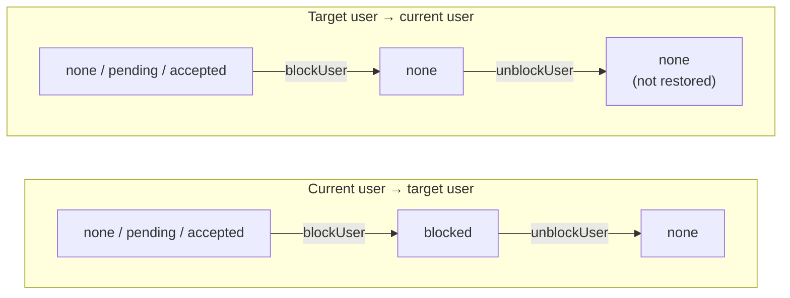

Use the block API when the current user wants to block another user. Use the unblock API to remove that block.

The SDK updates relationship data after block and unblock calls. TypeScript returns the updated payload (`follows` and `followCounts`). iOS, Android, and Flutter expose these actions as async or completable operations.

<Info>
Blocking removes any follow relationship between the two users, in both directions, and unblocking does not restore it. You don't need to call `unfollow` before `blockUser`. See [Effect on follow relationships](#effect-on-follow-relationships).
</Info>

## Parameters

| Operation | Parameter | Required | Description |
| --- | --- | --- | --- |
| Block user | `userId` / `targetUserId` | Yes | ID of the user the current user wants to block. |
| Unblock user | `userId` / `targetUserId` | Yes | ID of the user the current user wants to unblock. |

## Block User

Block a user when the current user wants to prevent or limit relationship-based interactions with that account.

<CodeGroup>

```kotlin Android
val disposable = AmityCoreClient.newUserRepository()
    .relationship()
    .blockUser(userId = targetUserId)
    .subscribe(
        {
            showSuccessMessage()
        },
        { error ->
            handleGeneralError(error)
        },
    )
```

```swift iOS
let relationship = AmityUserRelationship()
try await relationship.blockUser(userId: "target-user-id")
```

```typescript TypeScript
import { UserRepository } from '@amityco/ts-sdk';

const result = await UserRepository.Relationship.blockUser(userId);

const followStatus = result.follows[0]?.status;
const followCount = result.followCounts[0];
```

```dart Flutter
await AmityCoreClient.newUserRepository()
    .relationship()
    .blockUser(targetUserId);
```

</CodeGroup>

On TypeScript, `follows[0]` is the relationship from the current user to the blocked user, with status `blocked`. `followCounts[0]` holds the current user's updated follower, following, and pending counts. The response does not include the blocked user's counts.

### Handle the blocked-user limit

A network caps how many users one account can block, and how many accounts can block one user. Either limit makes the block call fail instead of succeeding:

- **The current user is at their block limit.** The call fails with a "maximum blocked users reached" error. On TypeScript this surfaces as the server error code `Amity.ServerError.MAX_BLOCKED_USERS_REACHED` (`400324`). Prompt the user to unblock someone before blocking another account.
- **The target user is already blocked by the maximum number of accounts.** The call fails with a general bad-request error that has no dedicated error code. Treat it as a generic failure.

<CodeGroup>

```kotlin Android
AmityCoreClient.newUserRepository()
    .relationship()
    .blockUser(userId = targetUserId)
    .doOnComplete {
        showSuccessMessage()
    }
    .doOnError { error ->
        if (AmityError.from(error) == AmityError.MAX_BLOCKED_USERS_REACHED) {
            // Already at the per-network block cap — prompt the user to unblock someone first.
            showBlockedUserLimitReached()
        } else {
            handleGeneralError(error)
        }
    }
    .subscribe()
```

```swift iOS
let relationship = AmityUserRelationship()
do {
    try await relationship.blockUser(userId: "target-user-id")
    showSuccessMessage()
} catch {
    if error.isAmityErrorCode(.maxBlockedUsersReached) {
        // Already at the per-network block cap — prompt the user to unblock someone first.
        showBlockedUserLimitReached()
    } else {
        handleError(error)
    }
}
```

```typescript TypeScript
import { UserRepository } from '@amityco/ts-sdk';

try {
  await UserRepository.Relationship.blockUser(userId);
} catch (error) {
  if (error?.code === Amity.ServerError.MAX_BLOCKED_USERS_REACHED) {
    showBlockedUserLimitReached();
    return;
  }
  handleError(error);
}
```

</CodeGroup>

## Unblock User

Unblock a user when the current user removes a previously created block. Unblocking a user who is not blocked fails with a bad-request error.

<CodeGroup>

```kotlin Android
val disposable = AmityCoreClient.newUserRepository()
    .relationship()
    .unblockUser(userId = targetUserId)
    .subscribe(
        {
            showSuccessMessage()
        },
        { error ->
            handleGeneralError(error)
        },
    )
```

```swift iOS
let relationship = AmityUserRelationship()
try await relationship.unblockUser(userId: "target-user-id")
```

```typescript TypeScript
import { UserRepository } from '@amityco/ts-sdk';

const result = await UserRepository.Relationship.unBlockUser(userId);

const followStatus = result.follows[0]?.status;
const followCount = result.followCounts[0];
```

```dart Flutter
await AmityCoreClient.newUserRepository()
    .relationship()
    .unblockUser(targetUserId);
```

</CodeGroup>

On TypeScript, `follows[0]` has status `none` after an unblock.

## Effect on Follow Relationships

A block replaces the follow relationship between the two users. The diagram and table show the status in each direction, where the current user is the one calling `blockUser` or `unblockUser`.



| Action | Current user → target user | Target user → current user |
| --- | --- | --- |
| Block | `blocked`. Replaces an existing `accepted` follow or `pending` request. | `none`. An `accepted` follow or `pending` request is removed. |
| Unblock | `none` | `none` |

- **Unblocking does not restore follows.** After an unblock, either user must follow the other again. On networks that require follow approval, that means a new follow request.
- **Follow counts change for both users.** The block removes up to one follower and one following entry from each user's counts. The block response carries only the current user's counts, so refresh the target user's counts wherever your UI shows them.
- **Following is rejected while a block is in place.** The current user can't follow a user they blocked, and the blocked user can't follow the user who blocked them. See [Follow/Unfollow User](../following/follow-unfollow-user).
- **To remove a block, call `unblockUser`.** Don't use `unfollow` to undo a block.

## After Block Or Unblock

After a successful block or unblock action:

- Refresh follow info if the current screen shows relationship status or counters.
- Refresh follower/following lists if the current screen displays social graph data.
- Refresh blocked-user lists if the current screen lets users manage blocked accounts.
- Hide content from users in either block direction with `excludeBlockUserPosts` and `excludeBlockUserComments`. See [Users Who Blocked You](./manage-blocking-users).

## Related Topics

<CardGroup cols={3}>
  <Card title="Manage Blocked Users" href="./manage-blocked-users" icon="list">
    Query the blocked-user list.
  </Card>
  <Card title="Users Who Blocked You" href="./manage-blocking-users" icon="user-slash">
    Query the reverse direction.
  </Card>
  <Card title="Follow/Unfollow User" href="../following/follow-unfollow-user" icon="user-plus">
    Change follow relationships.
  </Card>
</CardGroup>
