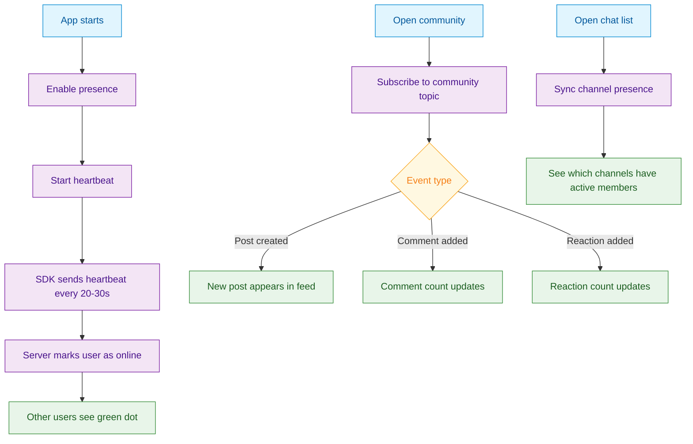
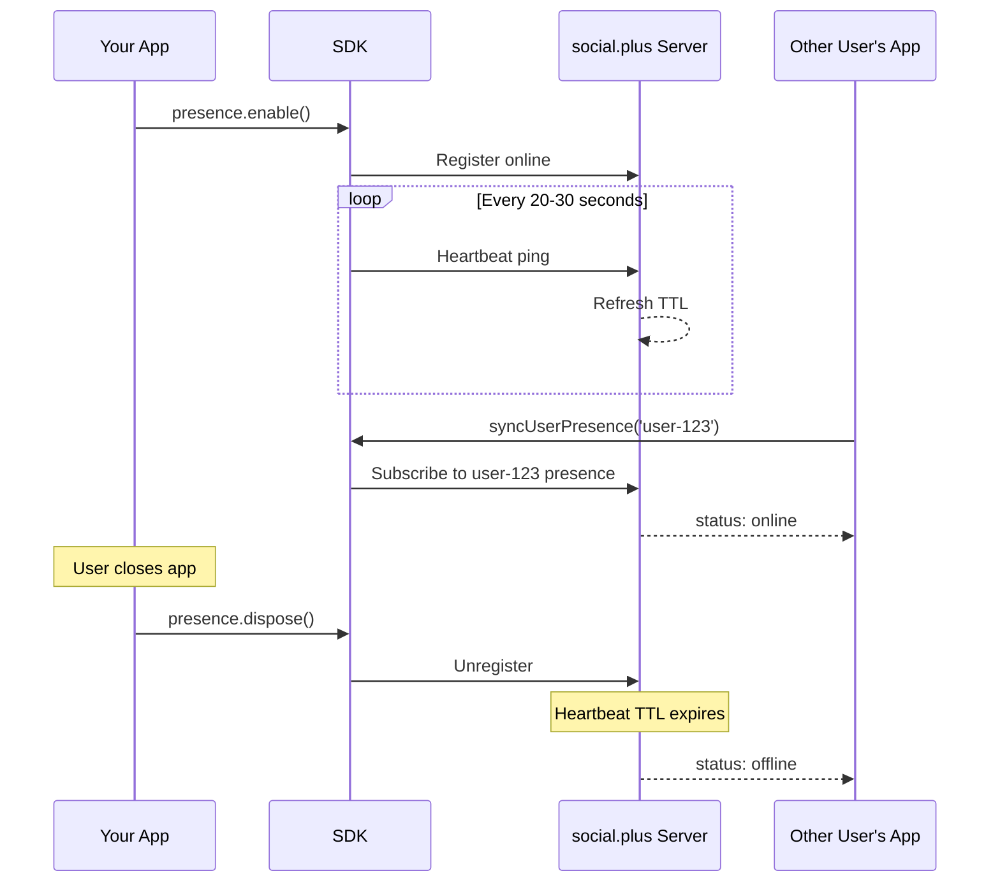

<Info>**SDK v7.x** · Last verified March 2026 · iOS · Android · Web · Flutter</Info>

<Accordion title="Speed run — just the code" icon="forward">
```typescript
// 1-2. User presence and the heartbeat are iOS and Android only: see Part 1

// 3. Observe a channel's online members
ChannelRepository.Membership.getMembers(
  { channelId: 'ch-123', filter: 'online' },
  ({ data }) => { renderOnlineUsers(data); }
);

// 4. Subscribe to real-time topic events
```
Full walkthrough below ↓
</Accordion>

<Tip>
**Platform note**: user presence and channel presence (Quick Start, Part 1 and Part 2) are available on iOS and Android only, so those samples use Swift and Kotlin. The TypeScript and Flutter SDKs do not expose them. Part 3 samples use the TypeScript SDK; see the linked SDK reference in each step.
</Tip>

Presence makes your app feel alive. When users can see who's online, which communities are active, and get instant content updates, engagement increases. This guide covers enabling user presence, syncing channel activity, managing heartbeats, and subscribing to real-time social events.



<Info>
**Prerequisites**: SDK installed and authenticated → [SDK Setup](/social-plus-sdk/getting-started/overview). Presence features must be enabled for your network — check **Admin Console → Settings**.
</Info>

<Note>
**After completing this guide you'll have:**
- Online/offline presence indicators on user avatars throughout the app
- Channel-level presence (who is currently viewing a community or room)
- Real-time event subscriptions for platform-wide activity tracking
</Note>

---

## Quick Start: Enable User Presence

<CodeGroup>

```swift iOS
let isEnabled = try await client.presence.isEnabled()
if !isEnabled {
    try await client.presence.enable()
}

try await client.presence.startHeartbeat()

// Call when the user should no longer appear online.
client.presence.stopHeartbeat()
```

```kotlin Android
AmityCoreClient.presence().isEnabled()
    .flatMapCompletable { isEnabled ->
        val enableIfNeeded = if (isEnabled) {
            Completable.complete()
        } else {
            AmityCoreClient.presence().enable()
        }

        enableIfNeeded.andThen(AmityCoreClient.presence().startHeartbeat())
    }
    .subscribeOn(Schedulers.io())
    .observeOn(AndroidSchedulers.mainThread())
    .subscribe({
        showSuccessMessage("Presence heartbeat started")
    }, { error ->
        showErrorMessage(error = error)
    })

// Call when the user should no longer appear online.
AmityCoreClient.presence().stopHeartbeat()
```

</CodeGroup>

Full reference → [Presence Overview](/social-plus-sdk/core-concepts/realtime-communication/presence-state/overview)

---

## Part 1: User Presence (Online/Offline)



<Steps>
  <Step title="Enable presence and start heartbeat">
    Enable presence tracking for the current user and start the automatic heartbeat. The SDK sends a heartbeat every 20-30 seconds to keep the user's online status current.

    <CodeGroup>

    ```swift iOS
    let isEnabled = try await client.presence.isEnabled()
    if !isEnabled {
        try await client.presence.enable()
    }

    try await client.presence.startHeartbeat()

    // Call when the user should no longer appear online.
    client.presence.stopHeartbeat()
    ```

    ```kotlin Android
    AmityCoreClient.presence().isEnabled()
        .flatMapCompletable { isEnabled ->
            val enableIfNeeded = if (isEnabled) {
                Completable.complete()
            } else {
                AmityCoreClient.presence().enable()
            }

            enableIfNeeded.andThen(AmityCoreClient.presence().startHeartbeat())
        }
        .subscribeOn(Schedulers.io())
        .observeOn(AndroidSchedulers.mainThread())
        .subscribe({
            showSuccessMessage("Presence heartbeat started")
        }, { error ->
            showErrorMessage(error = error)
        })

    // Call when the user should no longer appear online.
    AmityCoreClient.presence().stopHeartbeat()
    ```

    </CodeGroup>

    Full reference → [Heartbeat Sync](/social-plus-sdk/core-concepts/realtime-communication/presence-state/heartbeat-sync)
  </Step>
  <Step title="Query user presence">
    Check whether specific users are online. Query up to 220 users at once for a member list or chat contact screen.

    <CodeGroup>

    ```swift iOS
    let repository = AmityUserPresenceRepository()

    let presences = try await repository.getUserPresence(userIds: [userId])
    for presence in presences {
        let isOnline = presence.isOnline
        let lastHeartbeat = presence.lastHeartbeat
        showSuccessMessage("\(presence.userId): \(isOnline)")
    }
    ```

    ```kotlin Android
    val repository = AmityCoreClient.newUserPresenceRepository()

    repository.getUserPresence(listOf(userId))
        .subscribeOn(Schedulers.io())
        .observeOn(AndroidSchedulers.mainThread())
        .subscribe({ presences ->
            presences.forEach { presence ->
                val isOnline = presence.isOnline()
                val lastHeartbeat = presence.getLastHeartbeat()
                showSuccessMessage("${presence.getUserId()}: $isOnline")
            }
        }, { error ->
            showErrorMessage(error = error)
        })
    ```

    </CodeGroup>

    Full reference → [User Presence](/social-plus-sdk/core-concepts/realtime-communication/presence-state/user-presence)
  </Step>
  <Step title="Sync presence for real-time updates">
    For users visible on screen (profile page, chat list), sync their presence to get live updates when they come online or go offline. Max 20 synced users at a time.

    <CodeGroup>

    ```swift iOS
    let repository = AmityUserPresenceRepository()

    let cancellable = repository.getSyncingUserPresence()
        .sink(receiveCompletion: { completion in
            if case let .failure(error) = completion {
                handleError(error)
            }
        }, receiveValue: { presences in
            for presence in presences {
                showSuccessMessage("\(presence.userId): \(presence.isOnline)")
            }
        })

    repository.syncUserPresence(id: userId)

    // Call when the row or screen is no longer visible.
    repository.unsyncUserPresence(id: userId)

    _ = cancellable
    ```

    ```kotlin Android
    val repository = AmityCoreClient.newUserPresenceRepository()

    repository.getSyncingUserPresence()
        .observeOn(AndroidSchedulers.mainThread())
        .subscribe({ presences ->
            presences.forEach { presence ->
                showSuccessMessage("${presence.getUserId()}: ${presence.isOnline()}")
            }
        }, { error ->
            showErrorMessage(error = error)
        })

    repository.syncUserPresence(userId)

    // Call when the row or screen is no longer visible.
    repository.unsyncUserPresence(userId)
    ```

    </CodeGroup>

    Full reference → [User Presence](/social-plus-sdk/core-concepts/realtime-communication/presence-state/user-presence)
  </Step>
  <Step title="Get online users count">
    Display a global "X users online" counter for your platform.

    <CodeGroup>

    ```swift iOS
    let repository = AmityUserPresenceRepository()

    let count = try await repository.getOnlineUsersCount()
    showSuccessMessage(count)

    let snapshot = try await repository.getOnlineUsersSnapshot()
    let users = snapshot.users

    if snapshot.canLoadMore {
        await snapshot.loadMore()
    }
    ```

    ```kotlin Android
    val repository = AmityCoreClient.newUserPresenceRepository()

    repository.getOnlineUsersCount()
        .subscribe({ count ->
            showSuccessMessage(count)
        }, { error ->
            showErrorMessage(error = error)
        })

    repository.getOnlineUsersSnapshot()
        .subscribe({ snapshot ->
            val users = snapshot.getUsers()
            if (snapshot.canLoadMore()) {
                snapshot.loadMore().subscribe()
            }
        }, { error ->
            showErrorMessage(error = error)
        })
    ```

    </CodeGroup>

    Full reference → [User Presence](/social-plus-sdk/core-concepts/realtime-communication/presence-state/user-presence)
  </Step>
  <Step title="Handle app lifecycle">
    Stop the heartbeat when the app goes to the background and restart it when the app returns to the foreground. This prevents false "online" status while the app is minimized.

    <CodeGroup>

    ```swift iOS
    // App moved to the background
    client.presence.stopHeartbeat()

    // App returned to the foreground
    try await client.presence.startHeartbeat()
    ```

    ```kotlin Android
    // App moved to the background
    AmityCoreClient.presence().stopHeartbeat()

    // App returned to the foreground
    AmityCoreClient.presence().startHeartbeat().subscribe()
    ```

    </CodeGroup>

    Full reference → [Heartbeat Sync](/social-plus-sdk/core-concepts/realtime-communication/presence-state/heartbeat-sync)
  </Step>
</Steps>

---

## Part 2: Channel Presence

<Steps>
  <Step title="Sync channel presence">
    Track which channels have active members. Useful for chat lists showing an "active now" indicator when another member is online.

    <CodeGroup>

    ```swift iOS
    let repository = AmityChannelPresenceRepository()

    let cancellable = repository.getSyncingChannelPresence()
        .sink(receiveCompletion: { completion in
            if case let .failure(error) = completion {
                handleError(error)
            }
        }, receiveValue: { presences in
            for presence in presences {
                let isAnyMemberOnline = presence.isAnyMemberOnline
                showSuccessMessage("\(presence.channelId): \(isAnyMemberOnline)")
            }
        })

    repository.syncChannelPresence(id: channelId)

    // Call when the row or screen is no longer visible.
    repository.unsyncChannelPresence(id: channelId)

    _ = cancellable
    ```

    ```kotlin Android
    val repository = AmityChatClient.newChannelPresenceRepository()

    repository.getSyncingChannelPresence()
        .observeOn(AndroidSchedulers.mainThread())
        .subscribe({ presences ->
            presences.forEach { presence ->
                val isAnyMemberOnline = presence.isAnyMemberOnline()
                showSuccessMessage("${presence.getChannelId()}: $isAnyMemberOnline")
            }
        }, { error ->
            showErrorMessage(error = error)
        })

    repository.syncChannelPresence(channelId)

    // Call when the row or screen is no longer visible.
    repository.unsyncChannelPresence(channelId)
    ```

    </CodeGroup>

    Full reference → [Channel Presence](/social-plus-sdk/core-concepts/realtime-communication/presence-state/channel-presence)
  </Step>
  <Step title="Manage visible channels">
    Sync/unsync channels as the user scrolls through a chat list. Max 20 synced channels at a time.

    <CodeGroup>

    ```swift iOS
    let repository = AmityChannelPresenceRepository()

    repository.syncChannelPresence(id: channelId)

    // Later, when the channel list is dismissed.
    repository.unsyncAllChannelPresence()
    ```

    ```kotlin Android
    val repository = AmityChatClient.newChannelPresenceRepository()

    repository.syncChannelPresence(channelId)

    // Later, when the channel list is dismissed.
    repository.unsyncAllChannelPresence()
    ```

    </CodeGroup>

    Full reference → [Channel Presence](/social-plus-sdk/core-concepts/realtime-communication/presence-state/channel-presence)
  </Step>
</Steps>

---

## Part 3: Real-time Social Event Subscriptions

Beyond presence, you can subscribe to content events — new posts, comments, reactions — so your UI updates instantly without polling.

<Steps>
  <Step title="Subscribe to community events">
    Subscribe at different granularity levels: community-level, post-level, or comment-level.

    ```typescript TypeScript
    import { getCommunityTopic, SubscriptionLevels } from '@amityco/ts-sdk';

    // Subscribe to all post events in a community
    const topic = getCommunityTopic(community, SubscriptionLevels.POST);

    // Subscribe to posts AND comments
    const fullTopic = getCommunityTopic(community, SubscriptionLevels.POST_AND_COMMENT);
    ```

    Full reference → [Social Real-time Events](/social-plus-sdk/core-concepts/realtime-communication/realtime-events/social-realtime-events)
  </Step>
  <Step title="Subscribe to post and comment events">
    For a post detail screen, subscribe to comment-level events on a specific post.

    ```typescript TypeScript
    import { getPostTopic, getCommentTopic, SubscriptionLevels } from '@amityco/ts-sdk';

    // Subscribe to comment events on a post
    const postCommentTopic = getPostTopic(post, SubscriptionLevels.COMMENT);

    // Subscribe to a specific comment's events
    const commentTopic = getCommentTopic(comment);
    ```

    Full reference → [Social Real-time Events](/social-plus-sdk/core-concepts/realtime-communication/realtime-events/social-realtime-events)
  </Step>
  <Step title="Subscribe to follow events">
    Get real-time updates when someone follows or unfollows the current user.

    ```typescript TypeScript
    import { getMyFollowersTopic, getMyFollowingsTopic } from '@amityco/ts-sdk';

    const myFollowers = getMyFollowersTopic();
    const myFollowings = getMyFollowingsTopic();
    ```

    Full reference → [Social Real-time Events](/social-plus-sdk/core-concepts/realtime-communication/realtime-events/social-realtime-events)
  </Step>
</Steps>

---

## Connect to Moderation & Analytics

<AccordionGroup>
  <Accordion title="Presence analytics" icon="chart-bar">
    Track daily active concurrent users and peak online times in **Admin Console → Analytics Dashboard**. This helps with capacity planning and understanding peak engagement windows.
  </Accordion>
  <Accordion title="Admin Console: presence settings" icon="gear">
    Enable or disable presence features for your network in **Admin Console → Settings**. Presence can be toggled per-network without code changes.
  </Accordion>
  <Accordion title="Webhook: real-time event triggers" icon="webhook">
    Combine SDK real-time events with webhook events for server-side workflows. For example, subscribe to `post.created` in the SDK for instant UI updates, and also handle it via webhook for server-side indexing.

    → [Webhook Events](/analytics-and-moderation/social+-apis-and-services/webhook-event)
  </Accordion>
</AccordionGroup>

---

## Common Mistakes

<Warning>
**Forgetting to stop the heartbeat on logout**: if you start the current user heartbeat but don't stop it when the user logs out, the user appears "online" indefinitely.

<CodeGroup>

```swift iOS
// Stop the heartbeat before the user logs out
client.presence.stopHeartbeat()
```

```kotlin Android
// Stop the heartbeat before the user logs out
AmityCoreClient.presence().stopHeartbeat()
```

</CodeGroup>
</Warning>

<Warning>
**Setting the heartbeat interval too low** — Intervals under 5 seconds waste bandwidth and may trigger rate limits. The recommended minimum is 10 seconds.
</Warning>

<Warning>
**Subscribing to too many topics at once** — Each topic subscription maintains a WebSocket channel. Subscribe only to topics visible on screen and unsubscribe when the user navigates away.
</Warning>

## Best Practices

<AccordionGroup>
  <Accordion title="Presence UX" icon="circle">
    - Use a green dot for "online", grey dot for "offline", and show "Last seen X min ago" for recently active users
    - Don't show exact "last seen" timestamps for privacy — round to "a few minutes ago", "an hour ago", etc.
    - Let users opt out of showing their online status in profile settings
    - Use presence for supported online/offline availability in chat; do not label presence or channel-subscription state as "typing"
  </Accordion>
  <Accordion title="Performance" icon="gauge">
    - Respect the 20-user sync limit — sync only users currently visible on screen
    - Unsync users/channels as they scroll off screen; re-sync when they scroll back
    - Use `getUserPresence()` for one-time queries (member lists); use `syncUserPresence()` only for screens that need live updates
    - Stop heartbeat in background to avoid battery drain on mobile
    - Use `viewId` when the same user is displayed in multiple UI components to avoid duplicate unsubscriptions
  </Accordion>
  <Accordion title="Real-time event subscriptions" icon="bolt">
    - Subscribe at the highest useful level: one `getCommunityTopic(community, POST_AND_COMMENT)` subscription is better than separate post + comment subscriptions
    - Unsubscribe when the component/screen unmounts — don't leak subscriptions
    - Use real-time events for UI updates; use webhooks for server-side workflows
    - Don't subscribe to everything globally — only subscribe to topics the user is actively viewing
  </Accordion>
</AccordionGroup>

---

<Tip>
**Dive deeper**: [Real-time Communication Reference](/social-plus-sdk/core-concepts/realtime-communication/realtime-events/overview) has full parameter tables, method signatures, and platform-specific details for every API used in this guide.
</Tip>

## Next Steps

<Card
  title="Your next step → Notifications & Engagement"
  icon="arrow-right"
  href="/use-cases/social/notifications-and-engagement"
>
  Presence is live — now pair it with push notifications to keep users informed across sessions.
</Card>

Or explore related guides:

<CardGroup cols={3}>
  <Card title="Build a Social Feed" href="/use-cases/social/build-a-social-feed" icon="rectangle-list">
    Use Live Collections for real-time feed updates
  </Card>
  <Card title="Notifications & Engagement" href="/use-cases/social/notifications-and-engagement" icon="bell">
    Combine presence with notification delivery
  </Card>
  <Card title="User Profiles & Social Graph" href="/use-cases/social/user-profiles-and-social-graph" icon="user-group">
    Show online status on user profiles
  </Card>
</CardGroup>
